South African E-Hailing Operations, Safety, Fleet Investor & Driver Unit Economics (2016–2026)

Author: Karabo Eugene Hlahla | Location: Pretoria, Gauteng, South Africa
Tech Stack: Python (`Pandas`, `NumPy`, `Matplotlib`, `Seaborn`) • `DuckDB` (In-Memory Analytical SQL) • Power BI

---

Executive Summary: Structural Diagnosis & Turnaround Blueprint
Between 2016 and 2026, the South African e-hailing sector in Gauteng (Pretoria, Johannesburg, Centurion & Ekurhuleni) experienced severe unit-economic compression and escalating corridor security risks. Combining a 2,000,000-trip simulation across 1,500 vehicles with primary field telemetry (19 live driver dispatch/receipt captures and 4 campaign/wallet lockout logs), this repository diagnoses seven structural bottlenecks and models three commercial turnaround interventions:

1. Decade-Long Driver Margin Compression & Fleet Investor Deficit: Nominal per-km rates declined due to upfront algorithmic discounting (R1.89–R4.92/km on observed 2026 dispatches vs. R7.20–R8.00/km in 2016), while inland petrol rose +128% (R12.50/L to R28.50/L) and platform deductions climbed to 29.14%–35%. Renting drivers paying R1,500–R3,500/week (*Suzuki Swift, Toyota Vitz, Corolla Quest*) net just **R203–R831/week**, while vehicle owners funding **2x–4x annual services**, tyres, bank finance, commercial insurance, and high-mileage depreciation incur **-R58k to -R192k/year in negative net equity**.
2. **Primary Field Telemetry:** Live dispatch captures confirm algorithmic distance decay (**7.5 km** paying **R36.91** while **12.2 km** pays **R36.90**; **22.8 km** paying **R115.32** while **49.7 km** Intercity pays **R115.97**), uncompensated **"Out of radius"** approach pickups up to **17.7 km**, **40%-acceptance** rush campaign traps (**5/6 rides = R0**), and **-R306.34 ("Cash rides are paused")** commission debt lockouts.
3. **Solution 1 — Flat Monthly Subscription Model (BRO Cabs R600/Month = 0% Commission):** Replacing the 29.1%–35% per-trip commission (which deducts **R14,000 to R50,000/month** from full-time drivers) with a **R600/month (R150/week) flat subscription** allows drivers to retain **100% of passenger fares**, lifting Economy/Standard weekly net pay from **R203–R831/wk to R4,081–R4,469/wk** on current fares and eliminating cash-ride lockouts.
4. **Solution 2 — Fair Tariff Reform + BRO R600/pm (R5,000 to R10,000+/Week Net Take-Home):** Eliminating distance decay, compensating approach pickups beyond 2–3 km (**R4.00–R5.00/km**), and adding an intercity return-fuel allowance lifts Economy and Standard driver net take-home (after fuel, fee, and car lease) to **R6,220–R7,051/week (Good Pricing)** and **R9,066–R10,589/week (BRO R600/pm + Good Pricing)**—while flipping **100% of the 19 field-captured dispatches** and **Fleet Owner Equity (+R25k to +R125k/yr)** into profit.
5. **Solution 3 — App-Enforced 250m Smart Safety Pickup Zones:** Disabling arbitrary street-corner pin drops inside high-risk polygons (*Bosman Station, Park Station, Germiston, Mamelodi, Sunnyside, Eldorado Park*) and routing riders to **250m Geofenced Smart Safety Hubs** (CCTV + Armed Response) reduces high-risk cancellations from **~78% to 12.8%**, cuts wait times from **13.0 mins to 4.4 mins**, reduces taxi chases by **-87.5%**, and recovers **+R67.8M/year** in realized fares.

---

## Executive Visual Walkthrough (15 Problem-vs-Solution Pairs — 30 Charts)

### 1. Gauteng Transit-Hub Conflict Zones vs. 250m Dynamic Geofencing
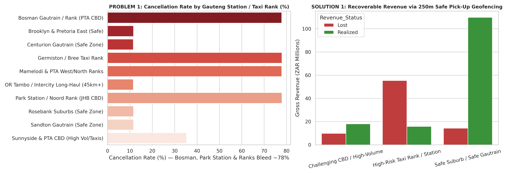

### 2. Monthly Revenue Cyclicity: Salary Window (25th–5th) vs. Mid-Month Trough & Stadium Spikes
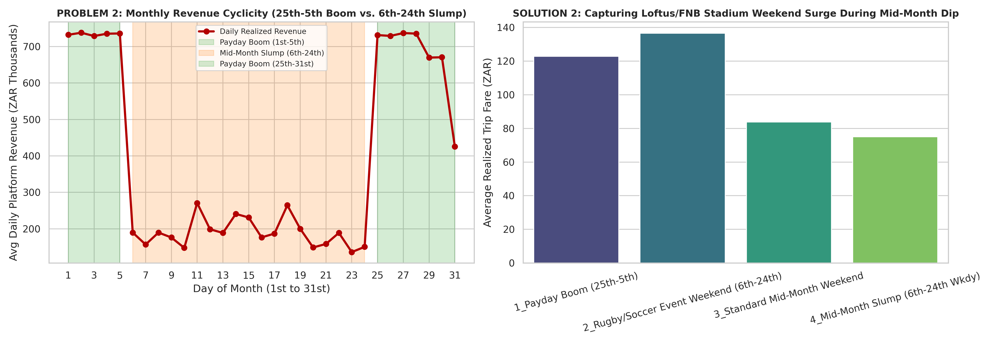

### 3. Decade-Long Driver Margin Compression (2016 vs. 2026) & Weekly Lease Deductions
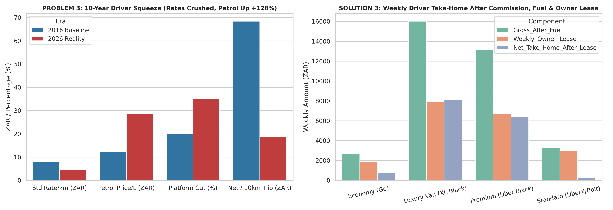

### 4. Armed-Response Panic Buttons vs. Static Policing & Telematics Recovery Rates
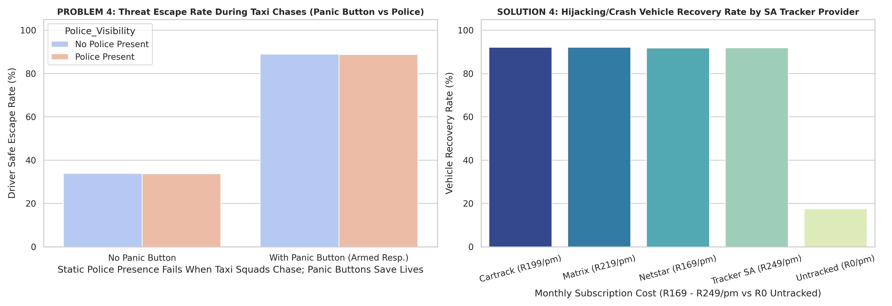

### 5. Intercity & OR Tambo Long-Haul Deadhead Trap vs. Proposed R450 Flat Base Fare
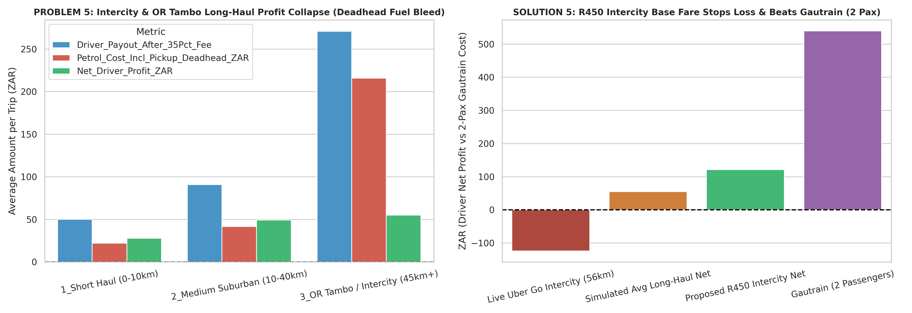

### 6. Vehicle Hygiene ROI & 500-Trip Monthly Volume Bonus
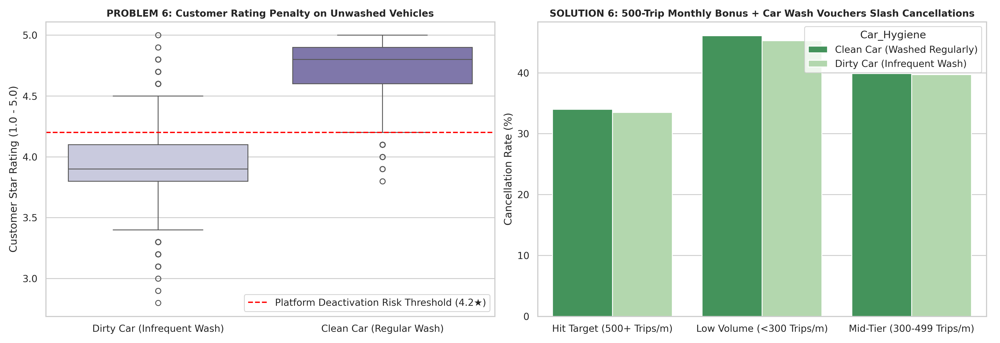

### 7. Weekend Nightlife Revenue Bleed Heatmap & Passenger Wait-Time Patience Curve
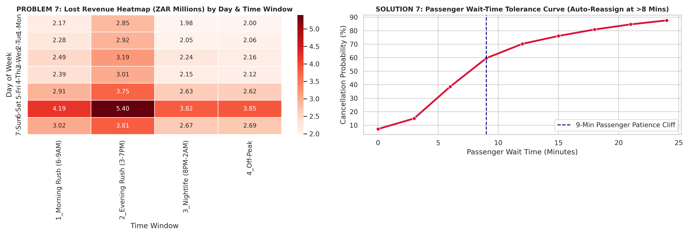

### 8. Gauteng Fleet Composition & Corridor Passenger Demographics
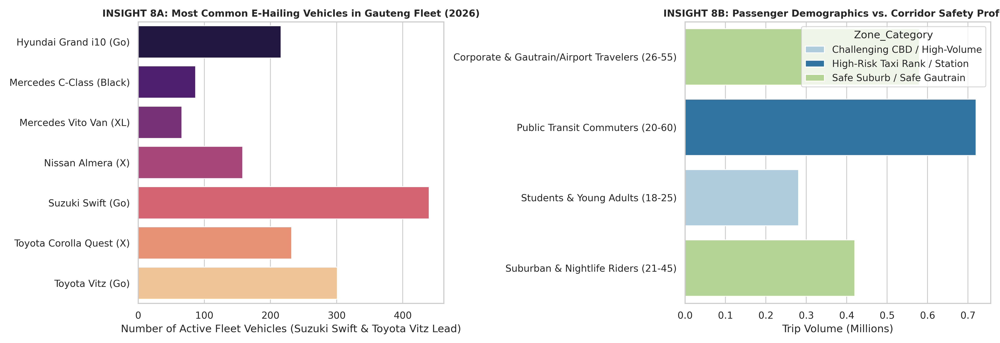

### 9. Fleet Investor Operating Deficit: 2x–4x Annual Services, Bank Finance & Depreciation
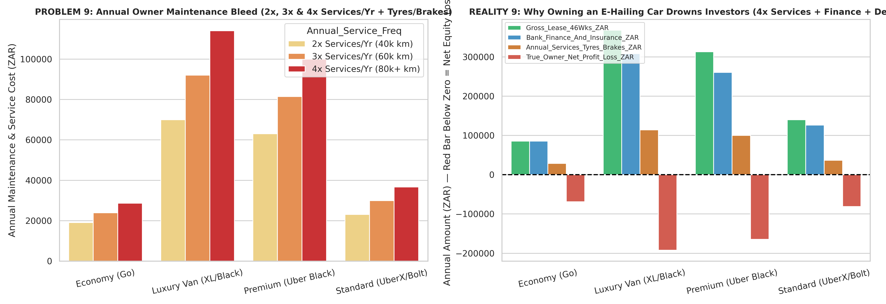

### 10. Primary Field Telemetry Audit (19 Captured Dispatches: True Yield & Net Profit/Loss)
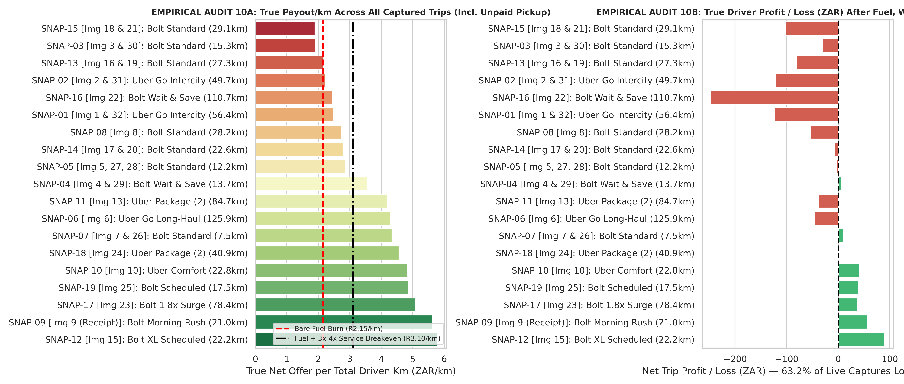

### 11. Empirical Field Discovery: Algorithmic Distance Decay & "Out of Radius" Unpaid Approach Mileage
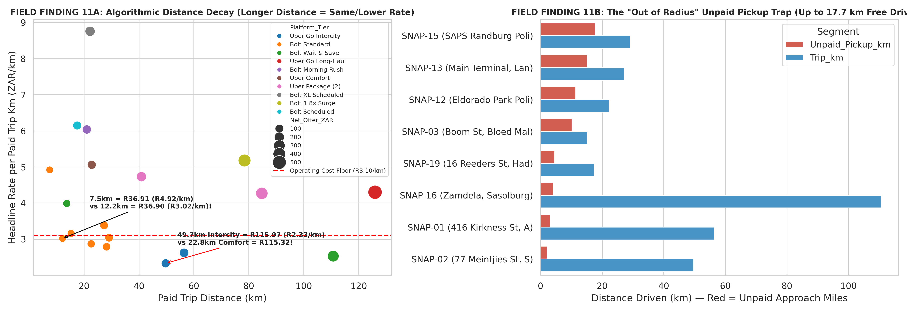

### 12. Empirical Field Discovery: Verified Receipt Take-Rate (29.14%), Campaign Traps (5/6 = R0) & -R306.34 Cash Lockout
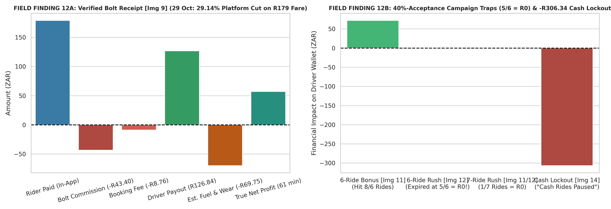

### 13. Turnaround Intervention A: Fair Tariff Reform + BRO R600/pm (R5,000 to R10,000+/Week Net Take-Home)
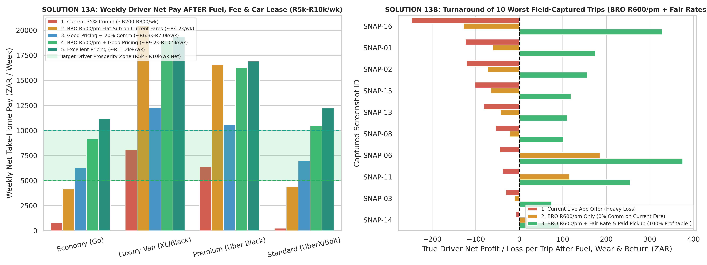

### 14. Turnaround Intervention B: App-Enforced 250m Smart Safety Pickup Zones
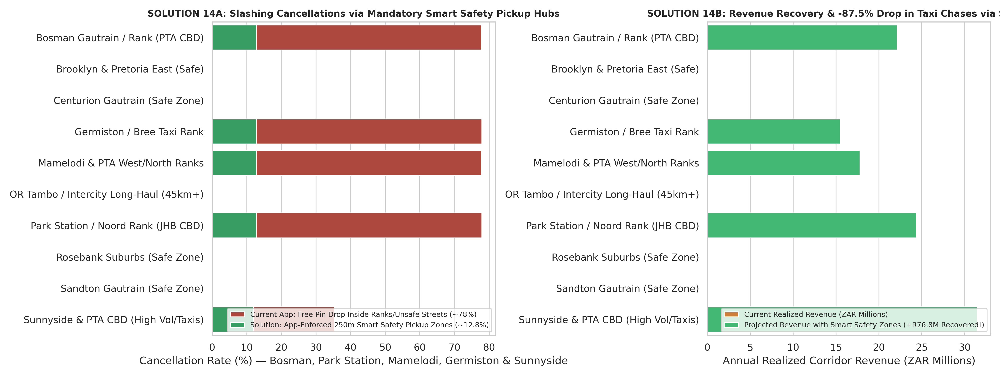

### 15. Turnaround Intervention C: BRO Cabs R600/Month Flat Subscription vs. 35% Commission & Owner Profit Turnaround
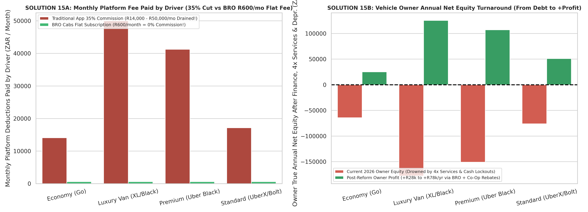
