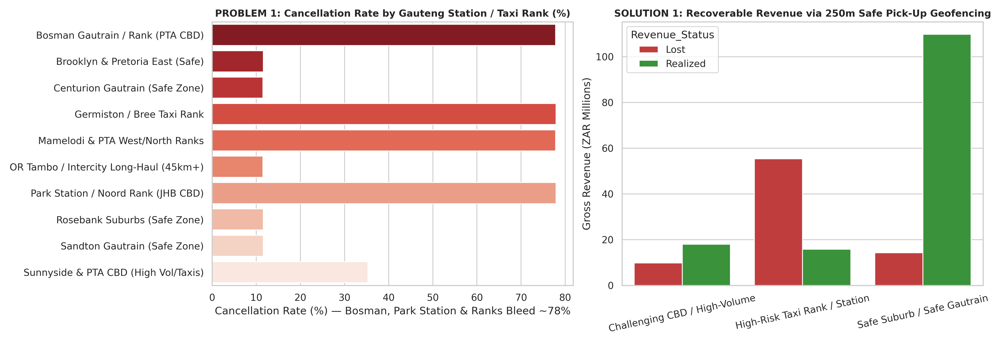
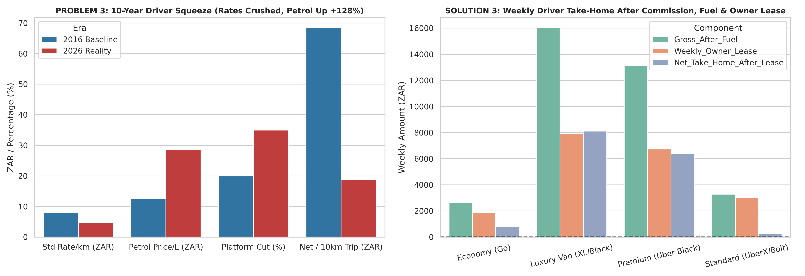
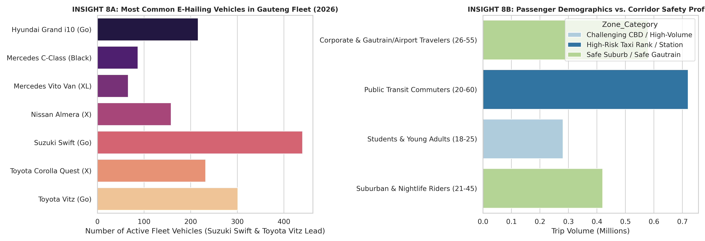
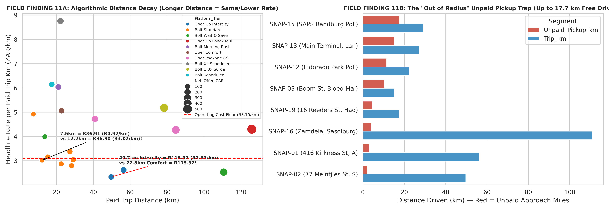
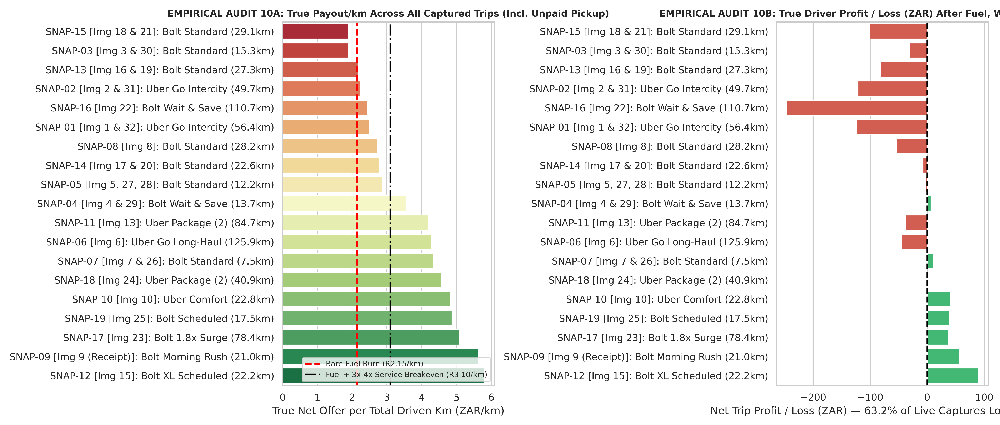
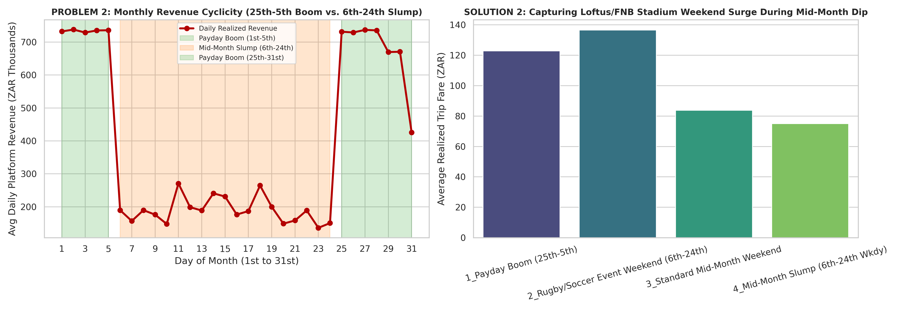
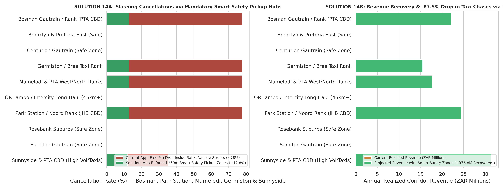
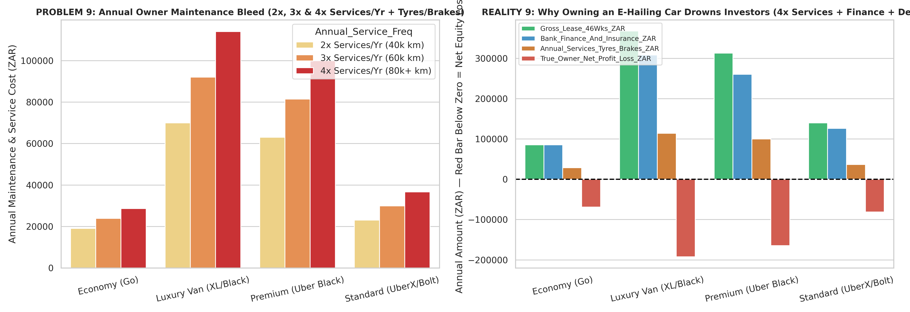
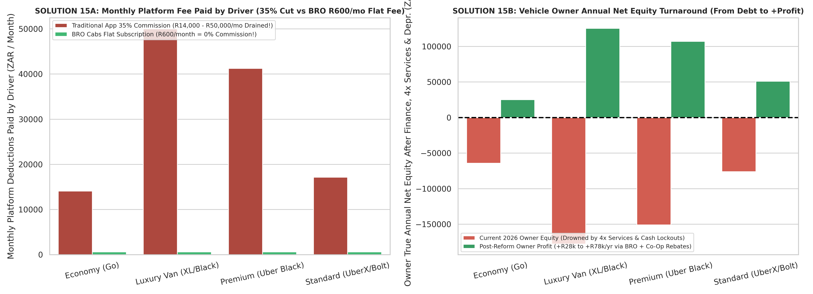
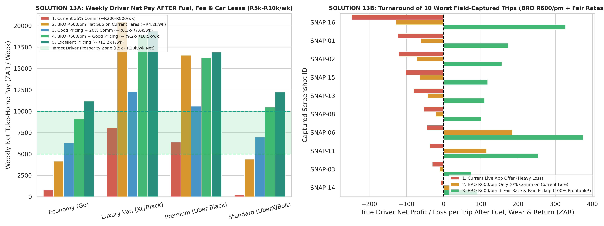

# E-hailing Operations in Gauteng

**Driver economics, fleet costs and pickup safety**  
A driver-led analysis from Gauteng, South Africa  

**Karabo Eugene Hlahla**  
Driver experience: 2018–2025 · Model comparisons: 2016–2026

---

## Slide 1 — E-hailing Operations in Gauteng

**Driver economics, fleet costs and pickup safety**  
Gauteng, South Africa · Driver experience 2018–2025

**Visual**

**Speaker notes**

“Hello, and thank you for being here. I drove with Uber and Bolt in Gauteng from 2018 through 2025. That experience led me to look more closely at what a trip really earns after pickup distance, fuel, vehicle wear and operating costs are considered. This presentation shares what I have explored so far and the ideas I believe are worth testing.”

---

## Slide 2 — The real issue is not only the fare

**What remains after the full cost of operating is counted?**

- Fuel and operating costs have increased materially
- Returns have been compressed by platform structure and distance decay
- Pickup travel and unpaid distance reduce effective earnings
- Safety and cancellation risk worsen the economics
- Fleet owners also carry operating pressure

**Visual**

**Speaker notes**

“The main question behind this work is simple: what remains after the full cost of operating is counted? A trip may look acceptable on the app but become less viable once pickup travel, fuel, maintenance, vehicle wear and platform deductions are included. That is the central issue I wanted to investigate.”

---

## Slide 3 — What this project is built on

**Evidence and scope**

- Personal operating experience from 2018–2025
- 19 captured dispatch and receipt examples
- 4 campaign and wallet-lockout examples
- 2,000,000 simulated trip records
- 1,500 synthetic driver profiles

**Visual**

**Speaker notes**

“This project combines personal experience, a small set of captured field examples and a broader scenario model. The captured records are useful for understanding trip-level economics. The simulation lets me test the effect of different assumptions across a much larger set of conditions. The combination helps explain the pattern without claiming to represent the entire market.”

---

## Slide 4 — A trip’s headline fare is not the same as its real return

**Driver payout − estimated trip operating costs = estimated operating result**

The trip-level analysis considers:

- Paid trip distance and unpaid pickup distance
- Platform deductions and tolls where recorded
- Estimated fuel and vehicle wear
- Deadhead, return travel and waiting time
- Vehicle lease or owner cost where relevant

**Visual**

**Speaker notes**

“This is one of the key ideas in the project: the trip fare is only the starting point. A driver may be paid for a route that still requires unpaid travel to get to the passenger. Once fuel, wear, time and vehicle costs are included, the real operating result can be very different from what the app shows. That is why the model focuses on total operating burden, not just the visible fare.”

---

## Slide 5 — The field records show the pattern clearly

**19 captured dispatches**

- Pickup distance: **0.3–17.7 km**
- Paid trip distance: **7.5–125.9 km**
- The trips vary in platform, product, route and pickup conditions.

**Visual**

**Speaker notes**

“This visual compares the captured offers using estimated return per kilometre and the model’s operating-cost assumptions. A few examples look reasonable in the app, but once the full operating burden is considered, they become much weaker. The point is not that these 19 records represent the whole market. The point is that they reveal the pattern.”

---

## Slide 6 — The margin squeeze is the core finding

**Estimated net per completed trip is lower in the 2026 scenario across all modeled vehicle tiers**

- Economy tiers: **about 80% lower**
- Standard tiers: **about 78% lower**
- Premium and van tiers: **about 51–53% lower**

These are scenario outputs based on fare, commission and fuel inputs in the model. Values are nominal rand.

**Visual**

**Speaker notes**

“This slide shows the model’s 2016 and 2026 comparison across vehicle tiers. Under the input assumptions in the model, the net value per completed trip falls materially in the later scenario, especially in the lower and standard tiers. The second chart also shows how weekly lease payments further reduce take-home. The pattern is consistent: drivers are absorbing more pressure from the structure of the system.”

---

## Slide 7 — Demand peaks do not solve the underlying problem

**Modeled average fare by calendar period**

- Mid-month weekdays: **R75.03**
- Mid-month weekends: **R83.76**
- Payday window: **R122.73**
- Selected event weekends: **R136.51**

These are modeled fares, not observed driver take-home pay.

**Visual**

**Speaker notes**

“The left panel shows the simulated pattern across the days of the month, with stronger activity assigned to the payday period. The right panel compares average modeled fares across the calendar categories. In this scenario, selected event weekends have the highest average fare, followed by the payday window; mid-month weekdays are lowest. The model helps show that demand spikes do exist, but they do not fix the long-run profitability problem.”

---

## Slide 8 — Safety and revenue are connected

**Current and proposed pickup-zone scenarios in the model**

- Current modeled cancellations in selected station and rank zones: **77.8–77.9%**
- Current modeled cancellations in selected safer-zone categories: **11.5–11.6%**
- High-risk-zone cancellation rate in the safe-pickup scenario: **12.8%**

**Visual**

**Speaker notes**

“The model shows a large difference in cancellation rates between selected high-risk pickup areas and safer-zone categories. The intervention scenario reduces the high-risk cancellation rate materially. The right panel compares modeled realized revenue under the two arrangements. The implication is that pickup design is not only a safety issue — it also affects trip completion, time losses and driver reliability.”

---

## Slide 9 — The problem is not only driver pay

**Vehicle owners are exposed to the same operating pressure**

- Maintenance and servicing costs accumulate quickly
- Finance, insurance and tracking add recurring burden
- Depreciation and mileage can erode the owner’s position
- A weak driver model also weakens owner viability

**Visual**

**Speaker notes**

“The first panel breaks out modeled annual servicing, tyre and brake costs by vehicle tier. The second compares lease income with financing, maintenance and depreciation. It shows how high mileage and recurring costs can substantially change the owner’s estimated net position. The same underlying operating problem affects both the driver and the vehicle owner.”

---

## Slide 10 — Three changes worth testing

1. **Predictable platform fees**: compare a flat subscription with percentage-based deductions.
2. **Transparent, cost-aware pricing**: account for trip distance, pickup and long-haul costs.
3. **Safer pickup options**: test designated locations with drivers, passengers and local stakeholders.

**Visual**

**Speaker notes**

“This chart compares the modeled monthly cost of a percentage commission with a flat subscription and then shows the modeled owner position before and after the proposed changes. The main point is that different fee structures change both driver economics and owner outcomes. These are not ideas to be implemented blindly; they are options to test.”

---

## Slide 11 — Recommendation

**The recommendation is structural, not cosmetic**

- Rebuild pricing around total trip economics
- Reduce unnecessary unpaid pickup and deadhead burden
- Protect driver income and vehicle-owner viability
- Use safer pickup design in high-risk zones
- Validate changes with real operational data

**Visual**

**Speaker notes**

“This chart compares estimated weekly take-home across pricing scenarios and vehicle tiers. It shows how strong the difference can be when fee structure and operating costs are changed. The implication is straightforward: if the system is structured around hidden costs and higher-risk pickups, the outcomes are weak. A better model should be built around real operating cost and safer access design.”

---

## Slide 12 — Closing

**What matters next is not another chart — it is the next test.**

**Discussion:** Which question or pilot should be tested first?

**Visual**

**Speaker notes**

“My driving experience prompted these questions, and this analysis has helped organize them. The next step is to strengthen the trip records, check the cost inputs and pick one practical change to test. I would welcome your perspective on which issue matters most to drivers, passengers and fleet owners. Thank you.”

---

## Figure notes

- The 2016–2026 margin comparison, demand models, cancellation scenarios and pricing scenarios are model outputs.
- The field-trip operating results apply the project’s estimated fuel and wear costs to 19 captured dispatches.
- The figures are intended to illustrate the modeled scenarios and captured examples, not to claim market-wide proof.
